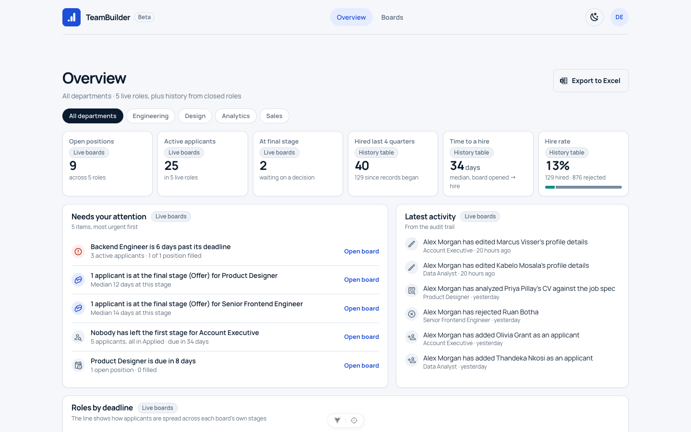
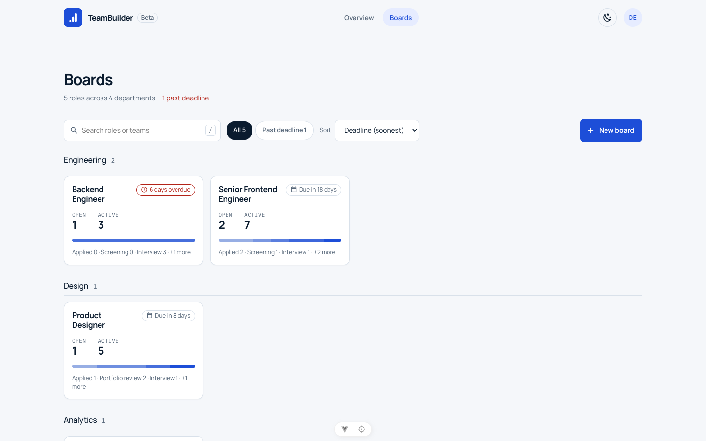
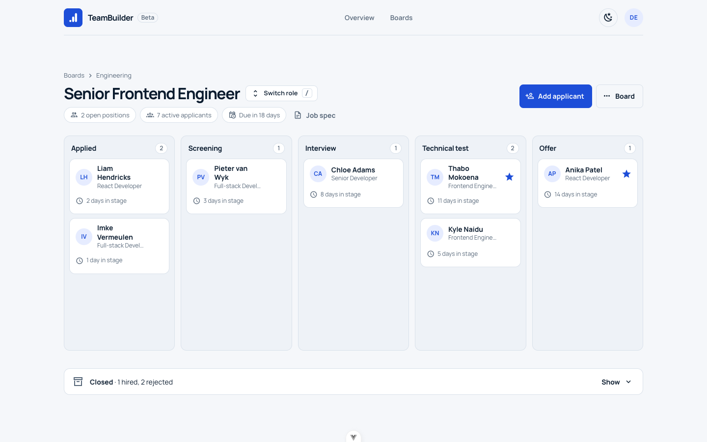
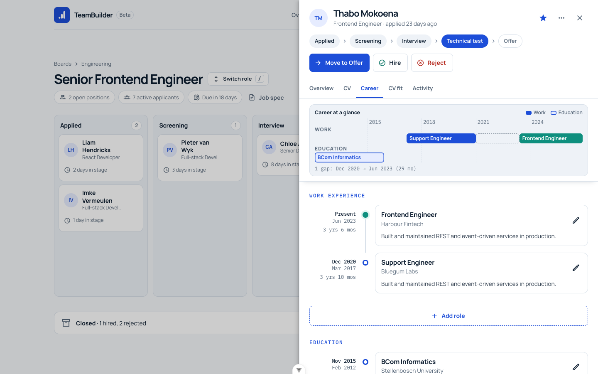
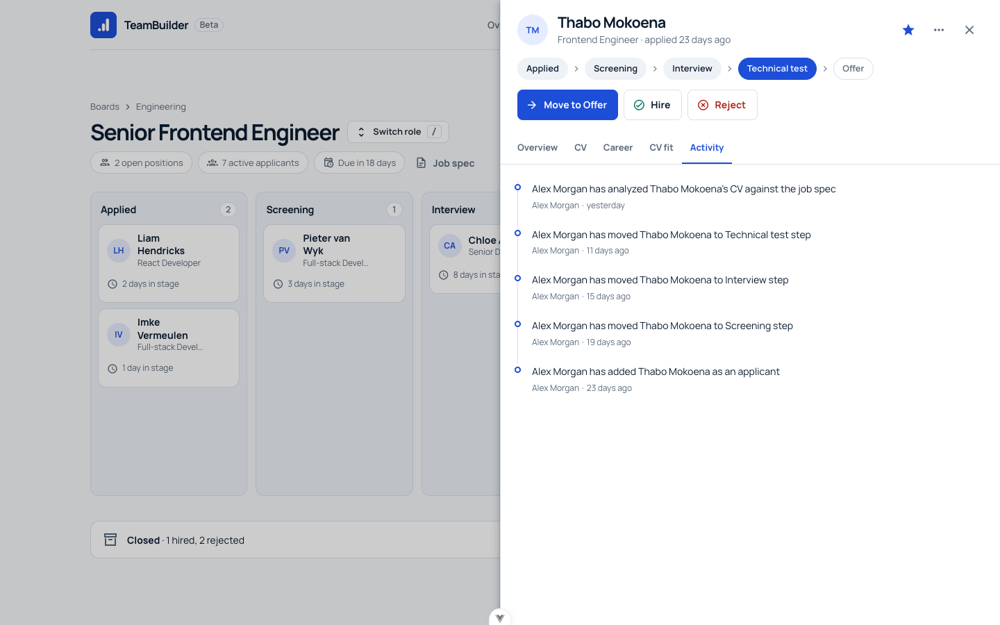

# TeamBuilder

A recruitment workspace built with Vue 3 and Supabase: role boards, applicant pipelines, a hiring overview, and consent-gated CV analysis.

- **Live demo:** https://michielhbrand.github.io/TeamBuilder/ (invite-only sign-in)
- **License:** [Apache-2.0](LICENSE)

## Features

- **Overview:** live KPIs, items needing attention, roles by deadline, quarterly hiring history, Excel export
- **Boards:** role boards grouped by department, each with its own stages
- **Pipeline:** stage columns with drag or keyboard moves, Hire and Reject with Undo
- **Applicant profile:** details, CV viewer, career timeline, notes, and an activity trail
- **CV fit:** compares redacted experience with the job spec using a free hosted model, after consent
- **Accounts:** invite-only, password setup, light and dark mode

## Screenshots

Dummy data from the local demo set.











## Run locally

Requires Node 22 (see `.nvmrc`) and Docker.

```bash
nvm use
npm ci
npm run supabase:start    # local Postgres, Auth, Storage, and Studio
npm run supabase:reset    # applies migrations and creates the local user
npm run dev:local         # http://localhost:5173
```

Sign in with `dev@example.com` / `LocalDev123!`. Override with `LOCAL_USER_EMAIL`,
`LOCAL_USER_PASSWORD`, and `LOCAL_USER_NAME` in `.env.local`.

- Studio: http://localhost:54323
- Invite emails (Mailpit): http://localhost:54324

Optional CV fit (set `KILO_MODEL` to a free model, such as `kilo-auto/free`):

```bash
cp supabase/functions/.env.example supabase/functions/.env
npm run supabase:functions    # second terminal
```

Stop the stack with `npm run supabase:stop`.

## Cloud setup

1. Create a Supabase project. Under **Authentication → URL Configuration**, set the Site URL to
   `https://michielhbrand.github.io/TeamBuilder/` and add `http://localhost:5173/` as a redirect URL.
2. Under **Authentication → Sign In / Providers**, disable new sign-ups.
3. Link and migrate:
   ```bash
   npx supabase link --project-ref <project-ref>
   npm run supabase:push
   ```
4. Deploy the CV fit function:
   ```bash
   npx supabase secrets set KILO_API_KEY=... KILO_MODEL=kilo-auto/free --remote=<project-ref>
   npx supabase functions deploy fit-analysis --remote=<project-ref>
   ```
5. Put `VITE_SUPABASE_URL` and `VITE_SUPABASE_PUBLISHABLE_KEY` in `.env.local`, then run `npm run dev`.
6. Invite users under **Authentication → Users → Invite user**. They set their password at `/set-password`.

## Environment

| Variable                        | Used by                  | Notes                                            |
| ------------------------------- | ------------------------ | ------------------------------------------------ |
| `VITE_SUPABASE_URL`             | Browser build            | Project URL, or `http://127.0.0.1:54321` locally |
| `VITE_SUPABASE_PUBLISHABLE_KEY` | Browser build            | `sb_publishable_...` only; never a secret key    |
| `KILO_API_KEY`, `KILO_MODEL`    | `fit-analysis` function  | Server-side secrets; never prefix with `VITE_`   |
| `LOCAL_USER_*`                  | `npm run supabase:reset` | Optional local seed user; local stack only       |

## Scripts

| Command                     | Purpose                              |
| --------------------------- | ------------------------------------ |
| `npm run dev` / `dev:local` | Dev server (cloud or local Supabase) |
| `npm run build`             | Typecheck and production build       |
| `npm test`                  | Unit tests                           |
| `npm run lint`              | Oxlint and ESLint                    |
| `npm run format:check`      | Prettier check                       |
| `npm run typecheck`         | `vue-tsc`                            |
| `npm run validate:env`      | Check the deploy environment         |

The full list is in `package.json`, and [AGENTS.md](AGENTS.md) has the checks to run before a change.

## Deploy

Pushes to `main` build and deploy to GitHub Pages through `.github/workflows/deploy.yml`, which
also deploys `fit-analysis`. The workflow needs these repository secrets: `VITE_SUPABASE_URL`,
`VITE_SUPABASE_PUBLISHABLE_KEY`, `KILO_API_KEY`, `KILO_MODEL`, `SUPABASE_ACCESS_TOKEN`, and
`SUPABASE_PROJECT_ID`. The production base path is `/TeamBuilder/`. See
[docs/ARCHITECTURE.md](docs/ARCHITECTURE.md) for the pipeline and failure modes.

## Commits and releases

Use [Conventional Commits](https://www.conventionalcommits.org/). `feat:` makes a minor release,
`fix:` a patch, and `feat!:` a major. `semantic-release` creates the releases.

## Documentation

- [AGENTS.md](AGENTS.md): commands, conventions, and constraints
- [docs/ARCHITECTURE.md](docs/ARCHITECTURE.md): auth, data, and deployment
- [docs/DESIGN_SYSTEM.md](docs/DESIGN_SYSTEM.md): Orbital UI rules
- [docs/DECISIONS.md](docs/DECISIONS.md): decision records

## License

Copyright 2026 Michiel Brand. Licensed under the [Apache License, Version 2.0](LICENSE).
